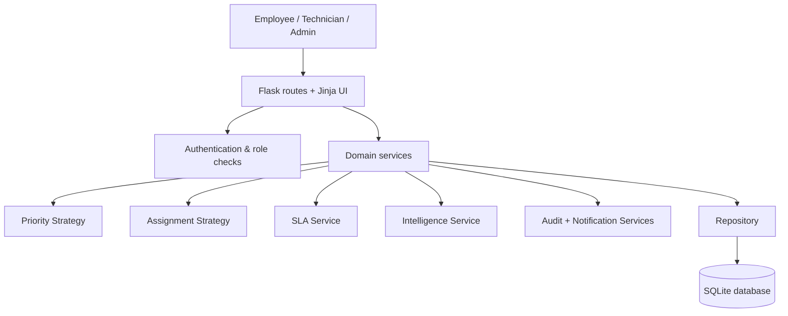
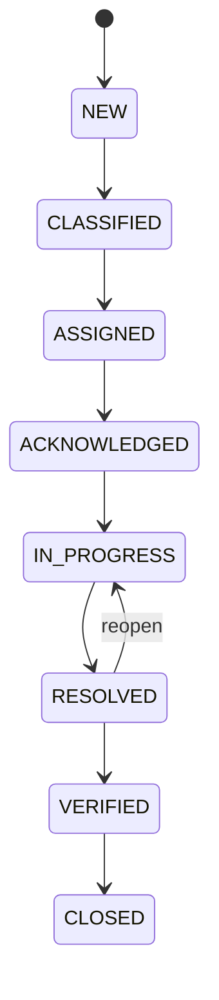
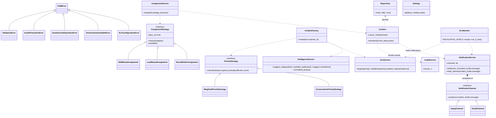
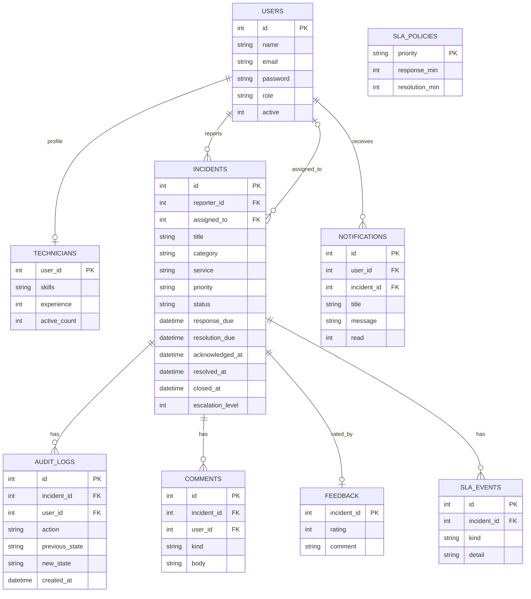
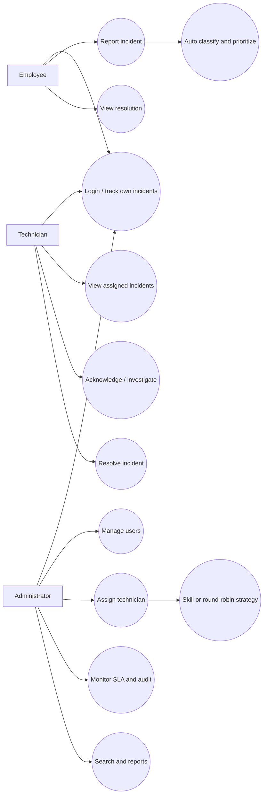

# Design and Requirements Notes

## 1. Problem analysis

Organizations rely on payment, authentication, database, network, cloud and communication services. Manually tracking failures creates delayed response, inconsistent priority, poor technician allocation, missed SLAs, duplicate reports and incomplete history. I-ITSM centralizes the incident lifecycle from report through classification, prioritization, assignment, investigation, resolution, verification and closure.

### Stakeholders
- Employee/customer: reports incidents, tracks progress and reads resolution.
- Technician/support engineer: acknowledges, investigates, records notes/resolution and updates status.
- Administrator/IT manager: manages accounts, assignment, incident oversight, audit and reports.

### Assumptions
- One organization and one shared SQLite database for the prototype.
- Priorities are P1–P4 and SLA targets follow the project brief.
- The application is a demonstration, not connected to production identity, email or SMS systems.
- The administrator performs assignment; the system recommends the technician.

## 2. Functional requirements
1. Authenticate users and enforce Employee, Technician and Administrator permissions.
2. Employees and administrators can create incidents with service, description, impact, urgency, criticality and affected-user count.
3. Suggest category and calculate priority automatically.
4. Admin can assign an incident with either skill/workload or round-robin strategy.
5. Enforce lifecycle transitions and record resolution details.
6. Calculate response and resolution deadlines and display SLA state.
7. Notify relevant users in the application and record audit events.
8. Detect possible duplicates and show related incidents.
9. Search incidents by ID/text, status, priority, category, service and technician.
10. Show incident, category, priority, service, SLA, satisfaction and technician workload reports.
11. Technicians add investigation notes and request information; reporters add information and reply.
12. Reporters confirm or reopen a resolved incident and give 1–5 feedback.
13. SLA monitor warns before deadlines, records violations and escalates unacknowledged incidents (Team Lead → IT Manager).
14. Correlate several open incidents on the same service and suggest resolutions from history.
15. Admin configures SLA policies, default assignment strategy and priority strategy; activates/deactivates accounts.
16. Read-only JSON API for incidents and statistics.

## 3. Non-functional requirements
- Maintainability: business rules separated into domain/service/repository classes.
- Security: password hashes, session authentication, role checks, parameterized SQL and input validation.
- Reliability: persistent SQLite data and controlled lifecycle transitions.
- Usability: role-specific navigation, responsive layouts and clear feedback.
- Portability: Python + Flask + SQLite; no paid services.

## 4. Architecture

The prototype uses a layered modular monolith. A single Flask application is appropriate for a small student team: simple deployment, low operational overhead and clear separation between presentation, domain services and persistence. The strategy interfaces allow algorithms to change without rewriting routes.

## 5. Lifecycle and business rules

A transition outside the defined state graph is rejected. Admin assignment records classification and assignment events. Only the assigned technician or an administrator can update technician work; employees can view only their own reports.

## 6. UML class diagram

## 7. ER model

## 8. Technology choices
- Python: readable OOP and quick iteration for a student project.
- Flask: lightweight routing and template rendering without a large framework overhead.
- SQLite: zero-configuration persistent relational database, suitable for a local prototype.
- Jinja + CSS: server-rendered interface keeps the stack small and easy to demonstrate.
- Alternatives: Django (more batteries included), FastAPI + React (separate API/frontend), PostgreSQL (better concurrency and deployment). A larger deployment should move to PostgreSQL, use a production WSGI server, external secret management and background SLA jobs.

## 9. Use case diagram

## 10. Data dictionary (core fields)

- `users`: identity, unique email, password hash, role and active flag.
- `technicians`: user foreign key, comma-separated skills, experience and current active workload counter.
- `incidents`: reporter and assignee foreign keys, title/description, category/service, impact/urgency/criticality, affected-user count, calculated priority, lifecycle status, timestamps, SLA deadlines and resolution text.
- `audit_logs`: incident/user references, action, description, previous/new state and timestamp.
- `notifications`: recipient, incident reference, title/body, timestamp and read flag.
- `email_outbox`: recipient address, subject/body, timestamp and `SIMULATED` delivery status.
- `settings`: key/value settings (default assignment strategy, priority strategy, round-robin pointer).
- `comments`: incident thread entries — `NOTE` (internal investigation note), `INFO_REQUEST` (to reporter), `INFO` (from reporter).
- `feedback`: one 1–5 rating and comment per incident.
- `sla_events`: warnings, response/resolution breaches and escalation levels, unique per incident and kind so each is recorded once.
- `sla_policies`: response and resolution targets (minutes) per priority, editable by the admin.
